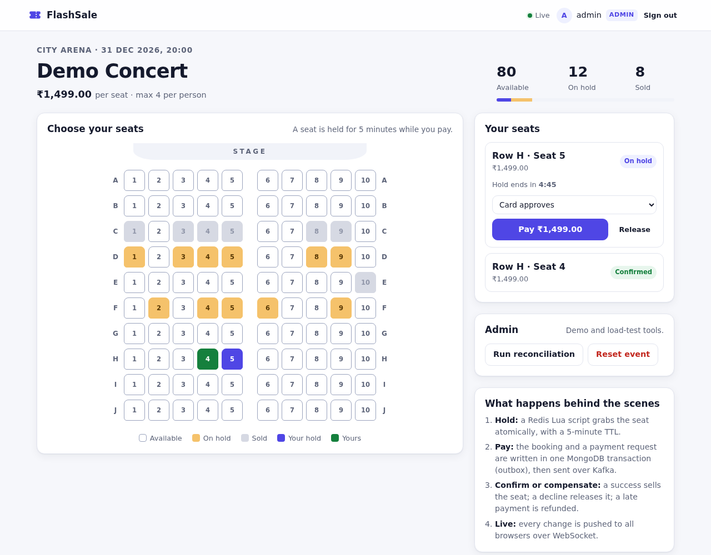
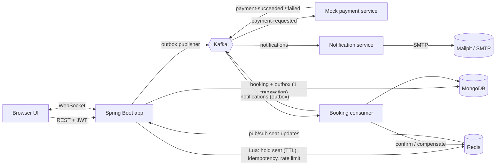

# FlashSale Engine

A ticket-booking system built for the worst case: thousands of users fighting over 100 seats at the same second. It never sells a seat twice, answers losers in milliseconds without touching the database, and recovers from payment failures, abandoned carts, duplicate requests and Redis data loss. Events are browsed on a calendar, and a Kafka-driven notification service emails tickets (with a calendar invite), declines, refunds and reminders.

**Stack:** Java 21 · Spring Boot 4.1 · MongoDB 8 · Redis · Apache Kafka 4 · WebSocket · Micrometer/Prometheus/Grafana · k6



## Architecture



| Step | What happens | Where |
|------|--------------|-------|
| 1. Hold | Seat number checked in memory, idempotency key `SET NX`, Lua script holds the seat for 5 min and enforces a 4-seat cap per user. Only winners write to MongoDB. | `BookingService.hold`, `hold_seat.lua` |
| 2. Pay | Hold extended to ≥ 2 min, booking moves `HELD → PAYMENT_PENDING` and a `PaymentRequested` row is written to the outbox **in one MongoDB transaction**. | `BookingService.pay` |
| 3. Publish | The outbox publisher forwards rows to Kafka (key = eventId). Kafka down? Rows wait. | `OutboxPublisher` |
| 4. Payment | Mock provider approves, declines, is slow or random. One payment per booking (unique index), so redelivery never charges twice. | `MockPaymentService` |
| 5. Confirm | Redis seat becomes `SOLD:user` (no TTL), booking `CONFIRMED`, seat document `BOOKED`, in a transaction. | `BookingConfirmationConsumer` |
| 5'. Compensate | Declined → release hold. Hold lost or seat already sold → booking `REFUNDED` and a `REFUND` command to the payment service, written to the outbox in the same transaction. | same, `MockPaymentService` |
| 6. Notify | Every change is published on Redis pub/sub and pushed to all browsers over WebSocket. | `SeatUpdateNotifier` |
| 7. Email | Confirm / decline / refund / expiry write a notification to the outbox **in the same transaction** as the status change. The notification service (own consumer group) emails it; a unique dedupe key per notification means a redelivered message never sends twice. Confirmations carry an `.ics` invite. | `BookingNotifications`, `NotificationService` |

Background jobs: `ExpiredHoldSweeper` (marks abandoned holds `EXPIRED`), `ReconciliationJob` (re-marks confirmed sales in Redis after data loss), `EventReminderJob` (one reminder per user 24 h before an event, exactly once per event), `DeadLetterMonitor` (counts poison messages).

### Booking state machine

```
HELD ──pay──> PAYMENT_PENDING ──ok──> CONFIRMED
 │                  │ ├──declined──> FAILED
 │                  │ └──hold lost / seat sold──> REFUNDED
 │                  └──hold expired──> EXPIRED ──late payment──> REFUNDED
 ├──user releases──> CANCELLED
 └──TTL──> EXPIRED
```

Every transition is a compare-and-set update (`BookingTransitions`), so two racing handlers can never both win.

## Guarantees and how they are enforced

| Guarantee | Mechanism | Safety net |
|-----------|-----------|------------|
| No seat sold twice | Atomic Lua hold in Redis | Partial unique index on `bookings {eventId, seatNo}` where `status = CONFIRMED` |
| No duplicate booking from retries | Per-user idempotency key in Redis | Unique index on `bookings.idempotencyKey` |
| No lost payment request | Outbox written in the same transaction as the status change | Outbox retries until Kafka accepts |
| No double charge / double confirm | Unique index on `payments.bookingId`; idempotent consumers | Retries (3 × 1 s), then dead-letter topic |
| Abandoned seats come back | Redis TTL | Sweeper updates booking documents |
| Redis data loss does not oversell | Reconciliation restores sales from MongoDB | Unique index rejects the second sale, buyer is refunded |
| Bots cannot hoard | Per-user seat cap (in the Lua script) and per-user rate limit (Redis) | |
| Passwords cannot be guessed | 5 wrong passwords lock the account for 15 min; per-IP limits on failed logins and sign-ups; same response time for unknown users | Password rules (8+ chars, letter + digit, not the username) |
| Stolen-token and CSRF risk is low | JWT in an `httpOnly`, `SameSite=Strict` cookie; cookie writes need the `X-Requested-With: FlashSale` header | Strict Content-Security-Policy, `X-Frame-Options: DENY` |
| Emails reach the right person | Sign-up sends a one-time verification link (token stored hashed, 24 h TTL); tickets only go to verified addresses | |
| Several instances do not step on each other | MongoDB leader lock per scheduled job (outbox, sweeper, reconciliation, reminders) | Every consumer is idempotent anyway |
| The database does not grow forever | TTL indexes: published outbox rows 7 d, email log 90 d, abandoned bookings 30 d | Confirmed bookings and payments are never deleted |

## Run it locally

Prerequisites (one time):

```bash
bash scripts/setup-user-tools.sh     # Kafka 4, k6, MongoDB 8, mongosh, Redis, Mailpit into ~/tools   [no sudo]
```

Optionally, `bash scripts/install-dev-tools.sh` installs MongoDB and Redis as system services instead (needs sudo). `start-local.sh` uses the system services when present and the `~/tools` copies otherwise.

Java 21 comes from SDKMAN (`sdk install java 21.0.12+1.1-tem`). Secrets live in `.env` (git-ignored): `JWT_SECRET` and `ADMIN_PASSWORD`. Create it from the template: `cp .env.example .env`, then fill in both values (`openssl rand -base64 32` for the JWT key).

Every day:

```bash
bash scripts/start-local.sh          # MongoDB, Redis, Kafka + topics, Mailpit
./mvnw spring-boot:run               # app + UI on http://localhost:8080
bash scripts/stop-local.sh           # free the RAM when done
```

Open **http://localhost:8080**, pick an event on the calendar, create an account (with an email) and pick a seat. Every email the app sends lands in the local fake inbox at **http://localhost:8025** (Mailpit); nothing leaves your machine. Open a second browser window as another user to watch seats change live. Sign in as `admin` (password in `.env`) for the reset and reconciliation buttons.

## API

| Method | Endpoint | Auth | Purpose |
|--------|----------|------|---------|
| POST | `/api/auth/register` | – | Create a user |
| POST | `/api/auth/login` | – | Get a JWT |
| GET | `/api/events?from=&to=` | – | Calendar feed (ISO instants, optional) |
| GET | `/api/events/{id}` | – | Event, price, live seat counts, `onSale` |
| GET | `/api/events/{id}/seats` | – | Seat map (`AVAILABLE` / `HELD` / `BOOKED`) |
| POST | `/api/bookings` | JWT + `Idempotency-Key` | Hold a seat → 200 `HELD`/`DUPLICATE`, 409 `SEAT_TAKEN`/`HOLD_LIMIT`/`IN_PROGRESS`, 429 |
| GET | `/api/bookings?eventId=` | JWT | My bookings |
| GET | `/api/bookings/{id}` | JWT | One booking |
| POST | `/api/bookings/{id}/pay` | JWT | Start payment (`SUCCESS`/`DECLINE`/`SLOW`/`RANDOM`) → 202 |
| POST | `/api/bookings/{id}/cancel` | JWT | Release a held seat |
| POST | `/api/baseline/bookings/{naive,atomic}` | JWT | DB-only baselines for benchmarks |
| POST | `/api/admin/events` | ADMIN | Create an event (name, venue, startTime, rows, seatsPerRow, price) |
| POST | `/api/admin/events/{id}/reset` | ADMIN | Reset the event |
| POST | `/api/admin/events/{id}/remind` | ADMIN | Send reminder emails now (demo) |
| POST | `/api/admin/events/{id}/reconcile` | ADMIN | Run reconciliation now |
| WS | `/ws/events/{id}` | – | Live seat updates |

Ready-made requests: [`api.http`](api.http) (VS Code REST Client).

## Tests

```bash
./mvnw test -DexcludedGroups=integration   # unit tests, no services needed
./mvnw test                                # everything; needs MongoDB + Redis running (Kafka is embedded)
```

| Test | Proves |
|------|--------|
| `ConcurrencyTest` | 1,000 simultaneous attempts on 100 seats: Redis and atomic-DB versions produce exactly 100 winners; the naive version oversells |
| `BookingFlowTest` | Idempotency (same key × 50 → one booking), seat cap, payment success, decline + release, cancel, reconciliation after Redis data loss, unique index blocking an oversell and refunding |
| `CalendarAndNotificationTest` | Admin-created events get seats and show up in the calendar range; started events refuse holds; confirmation email with `.ics`; decline email; redelivered notification sends one email; users without email are skipped; reminder sent once per user per event |
| `AuthSecurityTest` | Password rules; account lock after 5 failures; per-IP limits; unknown user answers like a wrong password; httpOnly cookie; CSRF guard (cookie without header → 401); Bearer still works; logout; security headers; verification link works once; no ticket emails to unverified addresses |
| `HardeningTest` | Leader lock (one holder; crashed holder expires); TTL indexes; purge date only on abandoned bookings; idempotency keys scoped per event |
| `BookingServiceTest` | Hot-path decisions with mocks |
| `BookingStatusTest` | State machine: legal and illegal transitions |

## Benchmarks

```bash
./mvnw spring-boot:run -Dspring-boot.run.profiles=loadtest   # terminal 1
bash scripts/benchmark.sh 3000                                # terminal 2: all three modes, ~4 minutes
```

The script runs k6 against the naive, MongoDB-atomic and Redis versions, and writes `benchmarks/results-<time>.md` with the table below, machine specs and load profile. The `loadtest` profile lifts the per-IP sign-up and per-user rate limits (the limiter still runs, so its cost is measured).

Results from [`benchmarks/results-20260927-170421.md`](benchmarks/results-20260927-170421.md): Intel i7-1255U laptop (12 threads, 15 GB RAM), with MongoDB, Redis, Kafka, the app and k6 all on the same machine; k6 ramping to 3,000 req/s over 15 s, held 45 s, 300 users, random seat out of 100.

| Mode | Throughput (req/s) | Median | p95 | p99 | Seats won | Dropped | Failed |
|------|-------------------|--------|-----|-----|-----------|---------|--------|
| Naive read-then-write | 1,600 | 317.9 ms | 1,139.8 ms | 1,750.4 ms | 100 | 44,142 | 0.00% |
| MongoDB atomic update | 1,529 | 411.4 ms | 901.1 ms | 1,314.4 ms | 100 | 45,246 | 0.00% |
| **Redis Lua hold** | **2,062** | **293.8 ms** | **397.6 ms** | **444.2 ms** | 100 | **11,245** | 0.00% |

Against the correct database-only version, the Redis hot path gives **35% more throughput, 56% lower p95 latency and 75% fewer dropped requests**.

**Overselling under true simultaneity** ([`benchmarks/oversell-20260927-172320.txt`](benchmarks/oversell-20260927-172320.txt)): 100 users fire at one seat at the same instant, 10 rounds. The naive version sold **199 bookings for 10 seats** (seat A01 alone 34 times); the MongoDB atomic and Redis versions sold exactly 10. The load test above spreads requests over 100 random seats, which is why the naive version does not visibly oversell there.

"Dropped" counts requests k6 could not start because the app fell behind. Pick a rate where the modes separate (at low rates they all keep up and look the same).

Naive shows 100 here because this test measures speed, not correctness. Requests spread over 100 random seats and the rate starts low, so two requests almost never race for the same seat. The oversell test below makes them race.

### Oversell test

```bash
bash scripts/oversell.sh        # terminal 2, same app as above: 100 users x 10 rounds, ~1 minute
```

In each round, 100 users try to book the same seat at the same instant. A correct method has exactly one winner per round.

| Mode | Winners (correct = 10) | Seats sold more than once |
|------|------------------------|---------------------------|
| Naive read-then-write | 199 | 10 of 10 (up to 34 buyers for one seat) |
| MongoDB atomic update | 10 | 0 |
| Redis Lua hold | 10 | 0 |

## Observability

`/actuator/prometheus` exposes `notifications_total{type,outcome}`, `bookings_held_total`, `bookings_rejected_total{reason}`, `bookings_confirmed_total`, `bookings_refunded_total{reason}`, `bookings_oversell_blocked_total`, `reconciliation_drift_total{type}`, `kafka_dlq_messages_total`, `outbox_pending`, HTTP latency histograms and Kafka consumer lag. Prometheus config: [`observability/prometheus.yml`](observability/prometheus.yml). Grafana: import [`observability/grafana-dashboard.json`](observability/grafana-dashboard.json).

## Design trade-offs

| Decision | Choice | Given up |
|----------|--------|----------|
| Hot path | Redis Lua, MongoDB unique index behind it | Two stores to keep consistent (hence reconciliation) |
| Database | MongoDB, one document per seat | No joins or foreign keys |
| Transactions | Only for booking + outbox and confirm | Needs a replica set |
| Flow | Synchronous hold, asynchronous payment | Eventual consistency (UI polls / listens) |
| Consistency across services | Saga with compensation | Compensation code per step |
| Broker | Kafka, partitioned by eventId | A very hot event becomes a hot partition |
| Shape | Modular monolith; payment only talks over Kafka | Not yet separately deployable |

## Project layout

```
com.flashsale
├── booking   hold/pay/cancel, saga consumer, state machine, sweeper, reconciliation
├── hold      Redis: Lua seat holds, idempotency store
├── seat      events, seats, catalog cache, seat view, DB-only baselines, seeding
├── payment   mock payment provider and its Kafka contract
├── notify    Redis pub/sub → WebSocket
├── admin     reset and reconcile endpoints
├── security  JWT auth, users
├── infra     Kafka (topics, retry, DLQ), outbox, Mongo config, metrics
└── common    errors, rate limiter
src/main/resources/static   the UI (plain HTML/CSS/JS, no build step)
scripts/ load/ observability/
```

## Deploy (Render)

[`Dockerfile`](Dockerfile) builds the app; [`render.yaml`](render.yaml) describes the Render setup (free web service + free Key Value for Redis). MongoDB (Atlas M0), Kafka (any SASL_SSL provider) and SMTP (Brevo) are external.

1. Run `./mvnw test` locally (the Docker build skips tests: the build machine has no MongoDB/Redis/Kafka).
2. Push the repository (it can be private) to GitHub, GitLab or Bitbucket.
3. Render dashboard: **New > Blueprint**, pick the repository, and fill in the secrets it asks for (`JWT_SECRET` from `openssl rand -base64 32`, Atlas URI, Kafka address and login, SMTP login).
4. Open `https://<service>.onrender.com`. The free instance sleeps after ~15 min idle; the first request then takes about a minute.

Settings come from environment variables (`SPRING_MONGODB_URI`, `SPRING_DATA_REDIS_URL`, `SPRING_KAFKA_*`, `SMTP_*`, `PORT`), so the same image runs locally and on Render. Do not load-test the hosted copy: free-tier limits are tiny.

## Limitations and next steps

- Payment is a mock: the refund command is delivered and recorded, but no real provider is called.
- One Redis node: the hold script is atomic but the node is a bottleneck (next: shard by event, the `{evtN}` hash tag is already in the keys).
- Hosting is a free-tier demo (sleeps when idle, small limits); benchmarks come from a local machine.
